<div align="center">

<picture>
  <source media="(prefers-color-scheme: dark)" srcset="assets/readme/banner-dark.svg">
  
</picture>

<p>
  <a href="https://gabrielevierti.github.io/learnmetal/"><b>Read the tutorials</b></a> ·
  <a href="https://gabrielevierti.github.io/learnmetal/it/index.html"><b>Versione italiana</b></a> ·
  <a href="#run-the-examples"><b>Examples</b></a> ·
  <a href="#the-learnmetal-engine"><b>Engine</b></a> ·
  <a href="#build-the-site"><b>Build the site</b></a>
</p>

</div>

**learnmetal** is a free, step-by-step tutorial site for learning 3D graphics programming with Apple's **Metal** API. It follows the classic "from a triangle to PBR" path: each chapter introduces one idea, explains why it works and shows the code that implements it. Chapters build on each other, so by the end you have a small renderer you understand line by line.

**→ Start reading at [gabrielevierti.github.io/learnmetal](https://gabrielevierti.github.io/learnmetal/)**

<picture>
  <source media="(prefers-color-scheme: dark)" srcset="assets/readme/features-dark.svg">
  
</picture>

## What you'll learn

| Section | Chapters |
| --- | --- |
| **Getting Started** | Introduction · Project Setup · Hello View · Hello Triangle · Shaders · Textures · Transformations · Coordinate Systems · Camera · Review |
| **Lighting** | Colors · Basic Lighting · Materials · Lighting Maps · Light Casters · Multiple Lights · Review |
| **Model Loading** | Model I/O · Mesh · Model |
| **Advanced Metal** | Depth Testing · Stencil Testing · Blending · Face Culling · Render Targets · Cubemaps · Advanced Data · Advanced MSL · Life Without Geometry Shaders · Instancing · Anti-Aliasing |
| **Advanced Lighting** | Blinn-Phong · Gamma Correction · Shadow Mapping · Point Shadows · Normal Mapping · Parallax Mapping · HDR · Bloom · Deferred Shading · SSAO |
| **PBR** | Theory · Lighting · Diffuse Irradiance · Specular IBL |
| **In Practice** | Debugging · Text Rendering · A 2D Game · A Game Engine · Engine: The Renderer · Engine: The Game · Engine: The Editor |
| **Beyond** | Compute Shaders · Tessellation · Ray Tracing · Mesh Shaders |
| **Apple Platforms** | Tile-Based GPUs · MetalFX Upscaling · Metal 4 · visionOS |

**Swift or C++.** Pick your language with the switch in the site's top bar. Swift uses MetalKit; C++ uses Apple's metal-cpp with GLFW.

**Live demos.** The demos run in your browser. The shader you edit is real Metal Shading Language, translated on the fly so it runs on any platform. To run Metal itself, you need a Mac with Xcode.

**Coming from another API?** Look for the **Coming from OpenGL** boxes, which map what you already know from OpenGL, Vulkan or Direct3D to Metal.

The site is in English, with an [Italian version](https://gabrielevierti.github.io/learnmetal/it/index.html) whose chapters are being translated.

## Run the examples

The [`examples/`](examples/) folder is a Swift package of runnable programs for the main chapters. Each one is a small macOS app that opens a window and renders with Metal. You need **macOS 13+** and **Xcode 15+** (or the matching command line tools).

```sh
cd examples
swift run HelloTriangle
swift run -c release Instancing      # release builds are much faster for the heavy examples
```

You can also open the package in Xcode (`open Package.swift`), pick an example in the scheme menu and press Run. Running from Xcode gives you API validation, the GPU frame debugger and the performance HUD.

<details>
<summary><b>All 17 Swift examples</b></summary>

<br>

| Target | Folder | Chapters |
| --- | --- | --- |
| `HelloView` | `01-HelloView` | Hello View |
| `HelloTriangle` | `02-HelloTriangle` | Hello Triangle |
| `Shaders` | `03-Shaders` | Shaders |
| `Textures` | `04-Textures` | Textures |
| `Transformations` | `05-Transformations` | Transformations |
| `CoordinateSystems` | `06-CoordinateSystems` | Coordinate Systems |
| `Camera` | `07-Camera` | Camera |
| `BasicLighting` | `08-BasicLighting` | Colors · Basic Lighting · Materials |
| `LightingMaps` | `09-LightingMaps` | Lighting Maps |
| `MultipleLights` | `10-MultipleLights` | Light Casters · Multiple Lights |
| `ModelLoading` | `11-ModelLoading` | Model I/O · Mesh · Model |
| `RenderTargets` | `12-RenderTargets` | Render Targets |
| `Instancing` | `13-Instancing` | Instancing |
| `ShadowMapping` | `14-ShadowMapping` | Shadow Mapping |
| `HDRBloom` | `15-HDRBloom` | HDR · Bloom |
| `PBR` | `16-PBR` | PBR Lighting |
| `ComputeParticles` | `17-ComputeParticles` | Life Without Geometry Shaders · Compute Shaders |

Shared code lives in `LearnMetalKit`. More detail in [`examples/README.md`](examples/README.md).

</details>

### C++ starter

[`examples-cpp/HelloTriangle`](examples-cpp/HelloTriangle/) is the Hello Triangle chapter in C++ with metal-cpp and GLFW:

```sh
brew install glfw cmake
# download metal-cpp from https://developer.apple.com/metal/cpp/ and unzip it into the folder as metal-cpp/
cmake -B build && cmake --build build
cd build && MTL_DEBUG_LAYER=1 ./LearnMetal
```

Run it from the `build` folder: `Shaders.metal` is loaded from the current directory and compiled at launch.

Both sets of examples can also be downloaded as zips from the [Example Code](https://gabrielevierti.github.io/learnmetal/resources/examples.html) page.

## The LearnMetal Engine

The tutorials end with a complete game engine written with Metal, twice: in Swift and in C++. It puts the chapters together into something you can make a game with, and it comes with **Marble**, a platform game, **FPV**, a simulated racing drone for Mac, iPhone and iPad, and a scene **editor** made with the engine itself. The four engine chapters in *In Practice* walk through its code.

<a href="https://github.com/gabrielevierti/learnmetal-engine"></a>

**→ [gabrielevierti/learnmetal-engine](https://github.com/gabrielevierti/learnmetal-engine)**

## Build the site

The site is generated from Markdown by a small Python script. It reads `content/`, and writes the finished site to `docs/`, which is what GitHub Pages serves.

```sh
pip install markdown pygments
python3 build.py
```

| Path | What it holds |
| --- | --- |
| `content/` | One Markdown file per chapter, plus `.cpp.md` (C++ variant), `.solutions.md` (exercise solutions) and `.it.md` (Italian) companions |
| `assets/` | Styles, scripts, live demos and images, copied into the site as-is |
| `examples/`, `examples-cpp/` | The runnable projects; `build.py` also zips them into `docs/downloads/` |
| `tools/` | Scripts that render the chapter figures and export the textures |
| `docs/` | The generated site. **Don't edit it by hand:** `build.py` deletes and rebuilds it on every run |

## Contributing

Corrections are welcome, from a typo to a wrong explanation. Open an issue or a pull request against the chapter's file in `content/`, then run `python3 build.py` to check the result.

## License

No license has been chosen yet: until one is added, all rights are reserved. The tutorials are free to read on the site.

---

<sub>Made by <a href="https://github.com/gabrielevierti">Gabriele Vierti</a> in Milan.</sub>
